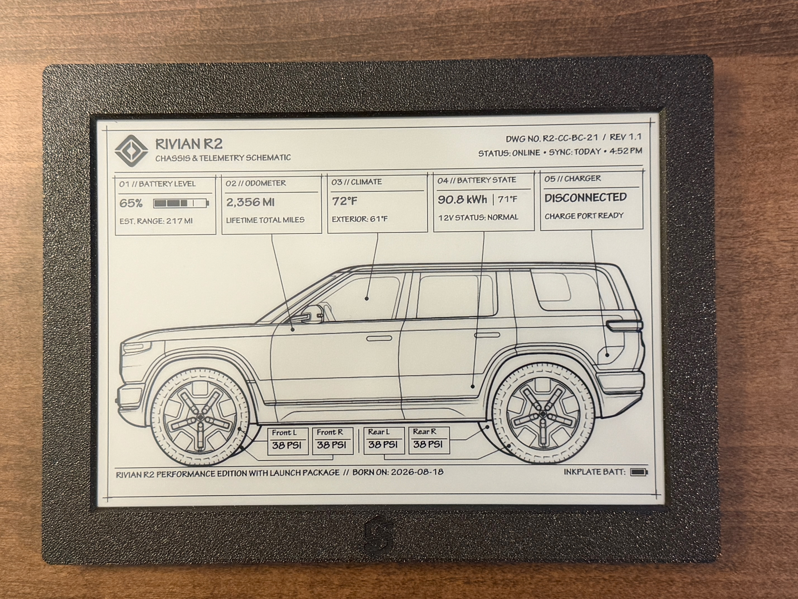
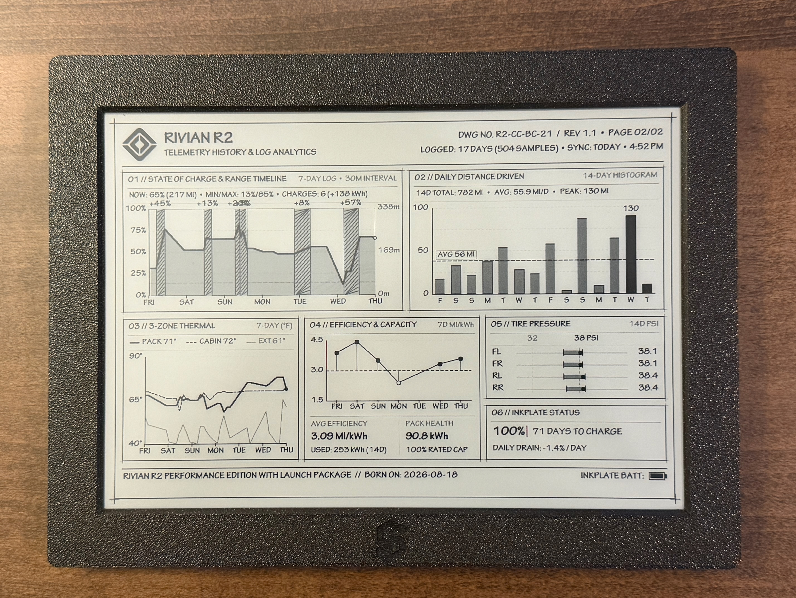

# Rivian Live Art Frame

A standalone, architectural-blueprint style art frame that displays live telemetry and 14-day driving/charging analytics for your Rivian—running **entirely on the device**.

**Secure & Private:** No vehicle data or credentials are ever sent to any third-party cloud service. The frame communicates directly with Rivian's API and **never stores your Rivian password** (only session tokens).

> **Want to have one of your own? You've got this!**  
> You don't need any programming experience to build this. If you can plug in a USB cable, install some software, and copy-paste a couple commands, the included **Setup Wizard** handles the rest in about 10 minutes.

| Page 1 — Live Telemetry Blueprint | Page 2 — 14-Day History & Analytics |
| :---: | :---: |
| [](docs/photos/display-page1.jpeg) | [](docs/photos/display-page2.jpeg) |

<sub>*Click either photo to expand to full size.*</sub>

---

## What it shows

* **Page 1 — Blueprint View**: Live battery percentage & range bargraph, odometer, cabin/exterior temperature, HV pack capacity & temperature, 12V battery health, charger status, and 4-corner live tire pressures (with low-battery and low-PSI alerts).
* **Page 2 — Telemetry Log View**: 7-day state-of-charge & charging session timeline, 14-day daily distance histogram, 3-zone thermal profile (pack/cabin/exterior), efficiency & pack health, 14-day tire pressure range, and Inkplate battery/runtime status. The wake button on the left side doubles as a page toggle.
* **Months of battery life**: The e-ink display doesn't drain the battery when it's not being updated. It goes into "deep sleep" when not being updated.

---

## I want one. How do I do it?

The only hardware you need is an **Inkplate 10**. I based the project off of this because it is a kit with a repurposed e-reader screen (keeps them out of landfills!) and an ESP32 processor and sufficient flash memory. I recommend getting the bundle with the 3D-printed frame (shown in the pics) and battery, so it doesn't have to be plugged in.

I got mine from Digikey: **[Inkplate 10 with Enclosure & Battery bundle (DigiKey)](https://www.digikey.com/en/products/detail/soldered-electronics/333247/21720382)** but there are other sources.

---

## Step 1: Install Python (if needed)

If you don't already have Python installed:

* **Windows**:
  1. Download Python from **[python.org/downloads](https://www.python.org/downloads/)** and run the installer.
  2. **Important:** On the very first screen of the installer, check the box at the bottom that says **"Add python.exe to PATH"**, then click **Install Now**.
* **macOS**:
  1. Download the macOS installer from **[python.org/downloads](https://www.python.org/downloads/)** and run it (or run `brew install python` if you use Homebrew).

---

## Step 2: Download This Project

* **Non-developers (no Git needed)**:
  1. Click the green **`<> Code`** button at the top of this page and choose **Download ZIP**.
  2. Unzip the downloaded folder somewhere easy to find (like your `Downloads` or `Desktop` folder).
* **Developers**:
  ```bash
  git clone https://github.com/markthomas/rivian-live-art-frame.git
  ```

---

## Step 3: Create a Dedicated Rivian Account (Recommended)

Rather than signing the frame into your primary Rivian account, I strongly recommend creating a free secondary Rivian account just for the display. That way it never conflicts with your phone app session, and you can revoke its access in one tap anytime.

> **Gmail Trick:** If you use Gmail, you don't need to create a brand-new email address! Just add `+rivian` to your username (for example, `yourname+rivian@gmail.com`). Rivian treats it as a separate account, while all emails and verification codes still land right in your normal Gmail inbox. Here's how to do it:

1. Open the **Rivian mobile app** (signed in to your primary account) and go to **Drivers and Keys** (or **Profile → Drivers**).
2. Tap **Add Driver** and invite your secondary email address (e.g., `yourname+rivian@gmail.com`).
3. Open the invitation email, click the link to **create a Rivian account** with that email and a new password, and **accept the vehicle invite**.
4. You'll use this new secondary email and password in Step 4 below.

---

## Step 4: Run the Setup Wizard

1. **Plug your Inkplate 10 into your computer** with the included USB data cable and turn the Inkplate **ON** (you'll see a blue LED light up).
2. **Open a terminal inside the unzipped `rivian-live-art-frame` folder**:
   * **Windows**: Open the unzipped folder in File Explorer, click the address bar at the top, type `cmd`, and press **Enter**.
   * **macOS**: Right-click the unzipped folder in Finder and choose **New Terminal at Folder** (or open Terminal, type `cd `, drag the folder into the window, and press **Enter**).
3. **Install the required packages and launch the Setup Wizard** (copy-paste these two lines):

   ```bash
   pip install -r requirements.txt
   python setup_frame.py
   ```

4. **Follow the prompts!** The wizard will automatically:
   * Detect your Inkplate 10 over USB
   * Flash MicroPython firmware if it's a brand-new board
   * Sign you into Rivian (supports 2FA) and auto-discover your vehicle name & "Born On" date
   * Ask for your **2.4 GHz Wi-Fi** network, timezone, and optional custom footer/drawing text
   * Upload everything to the Inkplate 10 and reboot it straight into your live dashboard!

---

## For Developers & Customizers

```text
├── setup_frame.py   # All-in-one interactive setup wizard (start here!)
├── device/          # MicroPython app & pre-built assets deployed to the Inkplate 10
├── firmware/        # Pre-built Inkplate 10 MicroPython firmware (.bin)
├── tools/           # Asset builder, Rivian auth helper, telemetry tester & mockup generators
├── assets/
│   ├── wireframes/  # Source vehicle wireframes (r2_wireframe.png)
│   └── fonts/       # Open-licensed Neucha font + SIL OFL license
├── docs/photos/     # Photos of the physical Inkplate 10 display
└── config.example.json
```

### Notes on Adapting for Another Vehicle (e.g., R1S or R1T)
Swapping in a different vehicle takes a little layout work—it's not just dropping in any image:
1. **Wireframe sizing**: Create a side-profile wireframe PNG sized to match the layout (`assets/wireframes/r2_wireframe.png` is `1130 × 430` px) and point `CONFIG["wireframe_file"]` in `tools/generate_mockup.py` to it.
2. **Reposition leader-line targets**: Update `CONFIG["terminal_dots"]` in `tools/generate_mockup.py` so each callout line points to the right spot on your vehicle (instrument cluster, cabin window, battery pack, charge port—which is at the front on an R1S/R1T vs. the rear on an R2—and the front/rear wheels).
3. **Preview & rebuild**: Check your alignment on desktop first with `python tools/generate_mockup.py` (saves to `local/previews/`), then run:
   ```bash
   python tools/build_assets.py
   ```
   This pre-renders the static 1200×820 blueprint templates and pre-rasterizes the font glyphs so the ESP32 can stamp live telemetry quickly with low RAM, then pushes the updated assets to your Inkplate 10.

---

## Roadmap

Here are some things I might add (perhaps with some help from volunteers)
* **R1S & R1T Support**: Wireframe templates and selectable vehicle profiles so R1S and R1T owners can run the same live art frame out of the box.
* **Zero-Install setup**: Make it even more non-developer friendly by building the setup steps into the frame itself. The idea is to present a QR code and act as a wifi access point so that you can provide the setup information via your phone.

---

## Questions & Feedback

I'll be monitoring the **[GitHub Discussion Forum](https://github.com/markthomas/rivian-live-art-frame/discussions)** for this project—feel free to ask questions, report issues, or share ideas.

If you build one—or adapt it for an **R1S** or **R1T**—I'd love to see it!
* Post photos, tips, or custom wireframes in **[GitHub Discussions (Show & Tell)](https://github.com/markthomas/rivian-live-art-frame/discussions/categories/show-and-tell)**
* Or tag me on X: **[@mrt11](https://x.com/mrt11)**

---

## Disclaimer & License

This is an independent, community-built project and is not affiliated with or endorsed by Rivian Automotive. It uses Rivian's unofficial consumer GraphQL/Parallax APIs, which may change without notice.

* Code is licensed under the **[PolyForm Noncommercial License 1.0.0](LICENSE)**: anyone can download, modify, and run it for personal/non-commercial use, and contribute improvements back; no commercial use or resale is permitted without a separate commercial license from the author.
* Bundled font **Neucha** is licensed under the SIL Open Font License 1.1 (`assets/fonts/Neucha-OFL.txt`).
